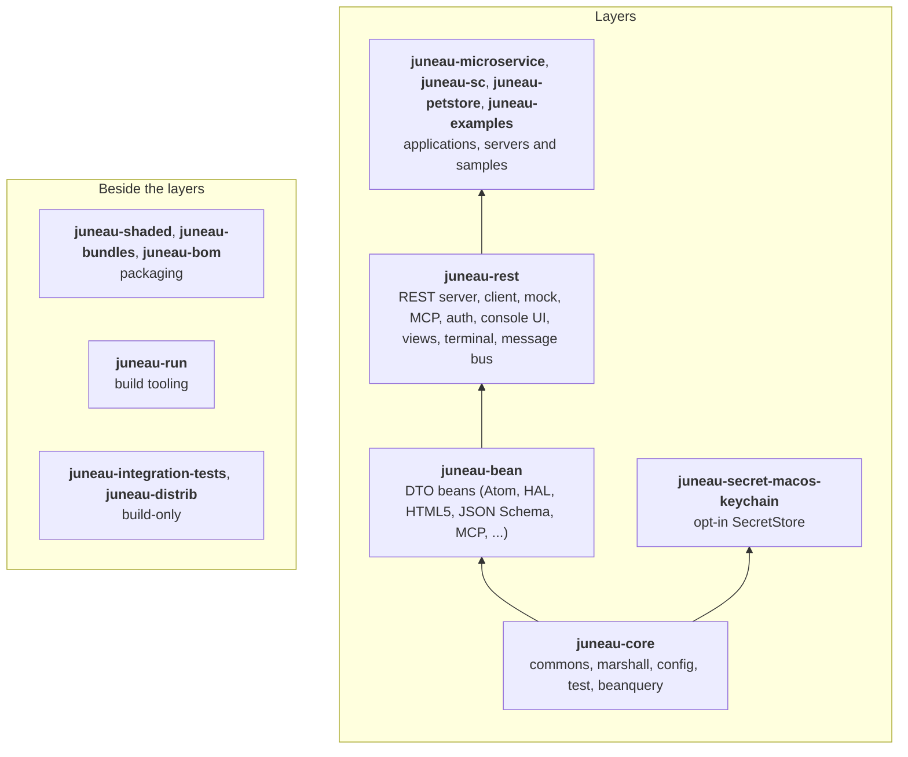

## About

Apache Juneau™ is a single cohesive Java ecosystem for marshalling Java objects to a wide variety of data formats and 
creating annotation-based REST end-to-end server and client APIs.

## Key Features

- **Universal Serialization** - Marshal POJOs to 38+ formats from a single API: JSON (plus JSON5, JSONL, JSON5L, and JCS), XML, SOAP, HTML, URL-Encoding, UON, OpenAPI, MessagePack, CBOR, BSON, YAML, TOML, HOCON, HJSON, CSV, INI, Markdown, Parquet, Protobuf, Prototext, SSE, and PlainText — plus 12 RDF variants (RDF/XML, RDF/XML-Abbrev, RDF/JSON, N-Triples, Turtle, N3, N-Quads, TriG, TriX, JSON-LD, RDF/Thrift, and RDF/Proto) via juneau-marshall-rdf
- **End-to-End REST** - Annotation-driven REST server and client that share a single API, with automatic Swagger/OpenAPI generation and self-documenting UIs
- **Transport-Agnostic REST Client** - Pluggable adapters for Apache HttpClient 4.5/5.x, OkHttp, and Jetty 12, including HTTP/2 request/response multiplexing and server push
- **DTO Beans** - Ready-made bean models for HTML5, Atom, HAL, JSON:API, JSON Patch, JSON Schema, OpenAPI v3, Swagger v2, RFC 7807 Problem Details, and MCP
- **Microservices** - Lightweight, standalone microservices with embeddable Jetty 12 or Tomcat 10+, or Spring Boot integration
- **Configuration Management** - Sophisticated configuration-file API (INI and YAML) with variable resolution
- **Bean-Centric Testing & Fluent Assertions** - Powerful fluent-style assertion framework plus JUnit 5 extensions and test-time bean injection
- **Large-Dataset Streaming** - BeanSupplier/BeanConsumer/BeanChannel and token/record streaming APIs for processing large datasets without loading all elements into memory; direct database integration via lifecycle methods (begin/acceptThrows/onError/complete)
- **Type Conversion** - Lightweight, MarshallingContext-free converter framework with caching and broad type support
- **Model Context Protocol (MCP)** - Built-in MCP server support for exposing REST resources to AI agents
- **Security** - Content Security Policy (CSP) support, plus opt-in JWT, SAML 2.0, OAuth 2.0, and OpenID Connect authentication
- **Zero / Minimal Dependencies** - Core marshalling requires no external dependencies, making it ideal for uber-jars

## Design Principles

- **Fast & memory-efficient** - High-throughput serialization and parsing with a low memory footprint
- **Safe by default** - Parsers are not susceptible to deserialization attacks
- **Lightweight** - juneau-commons (~850KB) + juneau-marshall (~2.1MB) with no required external dependencies
- **No magic (KISS)** - No auto-wiring, no code generation, no dependency injection — just add it to your classpath and use it
- **Exhaustively tested** - Extensive test coverage with lots of up-to-date documentation and examples
- **Modern & portable** - Requires Java 17+; all components are also packaged as stand-alone OSGi bundles

## Ecosystem

The Juneau ecosystem consists of the following parts, layered from the dependency-free core up to complete applications.
Packaging, build tooling and the build's own test and distribution modules sit beside the layers rather than in them:



| Maven Artifacts | Description | Prerequisites |
|-----------------|-------------|---------------|
| **juneau-core** | | |
| [juneau‑commons](/docs/topics/JuneauCommons) | Common utilities and APIs used across the Juneau ecosystem (collections, I/O, reflection, settings, SVL, etc.) | • *None* |
| [juneau‑test](/docs/topics/JuneauTest) | Fluent-style assertions, Bean-Centric Testing, and JUnit 5 extensions / test-time bean injection | • JUnit 5 |
| [juneau‑config](/docs/topics/JuneauConfig) | Configuration File API | • *None* |
| [juneau‑marshall](/docs/topics/JuneauMarshall) | Serializers and parsers for JSON (various flavors), XML, SOAP, HTML, URL-Encoding, UON, OpenAPI, MessagePack, CBOR, BSON, YAML, TOML, HOCON, HJSON, CSV, INI, Markdown, Parquet, Protobuf, Prototext, SSE, and PlainText | • *None* |
| [juneau‑marshall‑rdf](/docs/topics/JuneauMarshallRdf) | Serializers and parsers for RDF/XML (various flavors), N3, NTriple, and Turtle | • Apache Jena 5.x |
| [juneau‑beanquery‑sql](/docs/topics/JuneauCommonsBeanQuery) | Shared JDBC BeanQuery context (dialect-agnostic) | • *None* |
| [juneau‑beanquery‑postgres](/docs/topics/JuneauCommonsBeanQuery) | PostgreSQL dialect for the shared JDBC BeanQuery context | • *None* |
| [juneau‑test‑utils](https://github.com/apache/juneau/tree/master/juneau-core/juneau-test-utils) | Shared test infrastructure (commons-level; no juneau-marshall dependency) | • *None* |
| [juneau‑test‑marshall‑utils](https://github.com/apache/juneau/tree/master/juneau-core/juneau-test-marshall-utils) | Marshall-level shared test fixtures (bean tester, marshall-annotated POJOs, round-trip harness), used at test scope by downstream modules | • *None* |
| **juneau-bean** | | |
| [juneau‑bean‑atom](/docs/topics/JuneauBeanAtom) | DTO beans for the Atom 1.0 format | • *None* |
| [juneau‑bean‑common](/docs/topics/JuneauBeanCommon) | Shared DTO bean utilities and base types | • *None* |
| [juneau‑bean‑hal](/docs/topics/JuneauBeanHal) | DTO beans for HAL (Hypertext Application Language) | • *None* |
| [juneau‑bean‑html5](/docs/topics/JuneauBeanHtml5) | DTO beans for HTML5 elements | • *None* |
| [juneau‑bean‑jsonapi](/docs/topics/JuneauBeanJsonApi) | DTO beans for the JSON:API format | • *None* |
| [juneau‑bean‑jsonpatch](/docs/topics/JuneauBeanJsonPatch) | DTO beans for JSON Patch (RFC 6902) | • *None* |
| [juneau‑bean‑jsonrpc](/docs/topics/JuneauBeanJsonRpc) | DTO beans for the JSON-RPC 2.0 envelope | • *None* |
| [juneau‑bean‑jsonschema](/docs/topics/JuneauBeanJsonSchema) | DTO beans for JSON Schema | • *None* |
| [juneau‑bean‑mcp‑v20250618](/docs/topics/JuneauBeanMcp) | DTO beans for the Model Context Protocol (MCP) revision `2025-06-18` | • *None* |
| [juneau‑bean‑mcp‑v20260728](/docs/topics/JuneauBeanMcp) | DTO beans for the Model Context Protocol (MCP) revision `2026-07-28` (current) | • *None* |
| [juneau‑bean‑openapi‑v3](/docs/topics/JuneauBeanOpenApi3) | DTO beans for OpenAPI v3 | • *None* |
| [juneau‑bean‑rfc7807](/docs/topics/JuneauBeanRfc7807) | DTO beans for RFC 7807 Problem Details | • *None* |
| [juneau‑bean‑swagger‑v2](/docs/topics/JuneauBeanSwagger2) | DTO beans for Swagger / OpenAPI v2 | • *None* |
| **juneau-rest** (server) | | |
| [juneau‑rest‑common](/docs/topics/JuneauRestCommon) | REST APIs common to client and server side | • *None* |
| [juneau‑rest‑common‑classic](/docs/topics/JuneauRestCommon) | REST Common — Apache HttpClient 4.5-compatible facades | • Apache HttpClient 4.5 |
| [juneau‑rest‑server](/docs/topics/JuneauRestServer) | REST Servlet API | • Servlet 5.0+ |
| [juneau‑rest‑server‑rdf](/docs/topics/RestServerRdf) | REST Server RDF content-type support | • Apache Jena 5.x |
| [juneau‑rest‑server‑mcp](/docs/topics/JuneauRestServerMcp) | Model Context Protocol endpoint (revision-neutral core) | • *None* |
| [juneau‑rest‑server‑mcp‑v20250618](/docs/topics/JuneauRestServerMcp) | MCP endpoint adapter for revision `2025-06-18` | • *None* |
| [juneau‑rest‑server‑mcp‑v20260728](/docs/topics/JuneauRestServerMcp) | MCP endpoint adapter for revision `2026-07-28` (current) | • *None* |
| [juneau‑rest‑server‑reactive](/docs/topics/RestServerReactive) | JDK-native `Flow.Publisher` return-type support | • *None* |
| [juneau‑rest‑server‑reactive‑reactor](/docs/topics/RestServerReactive) | Reactor / RxJava 3 return-type bridge (opt-in) | • reactor-core or rxjava |
| [juneau‑rest‑server‑view‑jsp](/docs/topics/JspViewSupport) | JSP view-rendering bridge | • Servlet container with JSP support |
| [juneau‑rest‑server‑view‑thymeleaf](/docs/topics/ThymeleafViewSupport) | Thymeleaf view-rendering bridge | • Thymeleaf |
| [juneau‑rest‑server‑view‑mustache](/docs/topics/MustacheViewSupport) | Mustache view-rendering bridge | • Mustache.java |
| [juneau‑rest‑server‑view‑freemarker](/docs/topics/FreemarkerViewSupport) | Apache FreeMarker view-rendering bridge | • FreeMarker |
| [juneau‑rest‑server‑springboot](/docs/topics/JuneauRestServerSpringboot) | REST Spring Boot integration | • Spring Boot 3.x |
| [juneau‑rest‑mock](/docs/topics/JuneauRestMock) | REST Testing API | • *None* |
| **juneau-rest** (auth and observability) | | |
| [juneau‑rest‑server‑auth‑jwt](/docs/topics/AuthFilterFramework) | JWT bearer-token validation (opt-in) | • nimbus-jose-jwt |
| [juneau‑rest‑server‑auth‑saml](/docs/topics/SamlAuthSupport) | SAML 2.0 assertion validation (opt-in) | • OpenSAML |
| [juneau‑rest‑server‑auth‑oauth](/docs/topics/OAuthAuthSupport) | OAuth 2.0 / OIDC validation and client flows (opt-in) | • Nimbus SDK |
| [juneau‑rest‑server‑auth‑oidc‑rp](/docs/topics/OidcRelyingParty) | OpenID Connect Relying Party login (opt-in) | • Nimbus SDK |
| [juneau‑rest‑auth‑oauth‑flow](/docs/topics/OAuthAuthSupport) | Role-neutral OAuth 2.0 grant-flow and OIDC discovery primitives (opt-in) | • Nimbus SDK |
| [juneau‑rest‑server‑metrics‑micrometer](/docs/topics/RestServerMicrometerMetrics) | Micrometer MetricsRecorder bridge (opt-in) | • micrometer-core |
| [juneau‑rest‑server‑tracing‑otel](/docs/topics/RestServerOtelTracing) | OpenTelemetry TracerHook bridge (opt-in) | • opentelemetry-api |
| [juneau‑rest‑server‑management‑logging](/docs/topics/RestServerManagementLogging) | Management and structured logging support: dynamic log levels, log tail, and audit logging (opt-in) | • *None* |
| **juneau-rest** (console, views and terminal) | | |
| [juneau‑rest‑server‑console‑ui](/docs/topics/AdminConsoleChrome) | Themeable admin-console chrome: engine-agnostic theme, tags, and CSS (opt-in) | • *None* |
| [juneau‑rest‑server‑console‑ui‑freemarker](/docs/topics/AdminConsoleChrome) | FreeMarker delivery for the console chrome (`<@page>`, `<@card>`) (opt-in) | • FreeMarker |
| [juneau‑rest‑server‑console‑ui‑freemarker‑tests](https://github.com/apache/juneau/tree/master/juneau-rest/juneau-rest-server-console-ui-freemarker-tests) | Unit tests for the FreeMarker console chrome (build-only; not published) | • *None* |
| [juneau‑rest‑server‑datatables](/docs/topics/Converters) | DataTables server-side-processing query protocol adapter (opt-in) | • *None* |
| [juneau‑rest‑server‑views](/docs/topics/RichTableViews) | Rich DataTables view toolkit: declarative view definitions plus a client runtime (opt-in) | • *None* |
| [juneau‑rest‑server‑views‑markdown](/docs/topics/MarkdownViewRendering) | Optional markdown-to-HTML rendering for the views toolkit (opt-in) | • commonmark-java |
| [juneau‑rest‑server‑widgets](/docs/topics/DeclarativeWidgets) | Declarative widget beans (dialogs, forms, action bars, badges) (opt-in) | • *None* |
| [juneau‑run‑report](/docs/topics/RunViewRegion) | Run-view events and test-report readers (Surefire, JUnit XML, Jest, Playwright); no REST server dependency (opt-in) | • *None* |
| [juneau‑rest‑server‑terminal](/docs/topics/TerminalRegion) | Terminal region: a command's raw output rendered by xterm.js, fed by a byte-offset endpoint (opt-in) | • *None* |
| [juneau‑rest‑server‑bus](/docs/topics/ConsoleMessageBus) | Server half of the console message bus: `ServerBus`, `BusPolicy`, and the session POST and SSE stream (opt-in) | • *None* |
| [juneau‑rest‑server‑bus‑websocket](/docs/topics/ConsoleMessageBus) | Jakarta WebSocket transport for the console message bus; the servlet container supplies the WebSocket implementation (opt-in) | • Jakarta WebSocket 2.2 container |
| [juneau‑rest‑server‑terminal‑bus](/docs/topics/ConsoleMessageBus) | Bridge that connects terminal input to the server message bus (opt-in) | • *None* |
| **juneau-rest** (client) | | |
| [juneau‑rest‑client](/docs/topics/NextGenRestClient) | Transport-agnostic REST Client API (JDK `HttpClient` by default); see [Choosing a REST Client](/docs/topics/ChoosingARestClient) | • *None* |
| [juneau‑rest‑client‑classic](/docs/topics/JuneauRestClient) | Classic (Apache HttpClient 4.5-based) REST Client API | • Apache HttpClient 4.5 |
| [juneau‑rest‑client‑apache‑httpclient‑45](/docs/topics/RestClientApacheHttpClient45) | Apache HttpClient 4.5 transport adapter | • Apache HttpClient 4.5 |
| [juneau‑rest‑client‑apache‑httpclient‑50](/docs/topics/RestClientApacheHttpClient50) | Apache HttpClient 5.x transport adapter | • Apache HttpClient 5.x |
| [juneau‑rest‑client‑okhttp](/docs/topics/RestClientOkHttp) | OkHttp 5.x transport adapter | • OkHttp 5.x |
| [juneau‑rest‑client‑jetty](/docs/topics/RestClientJetty) | Jetty 12 HttpClient transport adapter | • Jetty 12 |
| [juneau‑rest‑client‑mcp](/docs/topics/JuneauRestClientMcp) | Model Context Protocol client core (revision-neutral) | • *None* |
| [juneau‑rest‑client‑mcp‑v20250618](/docs/topics/JuneauRestClientMcp) | MCP client adapter for revision `2025-06-18` | • *None* |
| [juneau‑rest‑client‑mcp‑v20260728](/docs/topics/JuneauRestClientMcp) | MCP client adapter for revision `2026-07-28` (current) | • *None* |
| [juneau‑rest‑client‑mcp‑auth](/docs/topics/JuneauRestClientMcp) | MCP client-side OAuth 2.1 token acquisition (opt-in) | • Nimbus SDK |
| **juneau-microservice** | | |
| [juneau‑microservice](/docs/topics/JuneauMicroservice) | Microservice base framework | • *None* |
| [juneau‑microservice‑jetty](/docs/topics/JuneauMicroserviceJetty) | Jetty-based microservice implementation | • Jetty 12 |
| [juneau‑microservice‑tomcat](/docs/topics/JuneauMicroserviceTomcat) | Tomcat-based microservice implementation | • Tomcat 10+ |
| [juneau‑microservice‑test](/docs/topics/MicroserviceTesting) | JUnit 5 `@MicroserviceTest` extension: boots a whole microservice on an ephemeral port for integration tests, with `@TestBean` mock injection | • JUnit 5 |
| [juneau‑microservice‑examples](https://github.com/apache/juneau/tree/master/juneau-microservice/juneau-microservice-examples) | Example and demo REST resources for the microservice (not shipped as a framework artifact) | • *None* |
| **juneau-sc** | | |
| [juneau‑sc‑server](/docs/topics/ScServerOverview) | Server Config Server API | • Servlet 5.0+ |
| **juneau-secret-macos-keychain** | | |
| [juneau‑secret‑macos‑keychain](/docs/topics/JuneauCommonsSettings) | Opt-in `SecretStore` backed by the macOS `security` keychain CLI | • macOS |
| **juneau-petstore** | | |
| [juneau‑petstore](/docs/topics/JuneauPetstore) | Complete petstore showcase application (aggregator for the modules below) | • Servlet 5.0+<br/>• Spring Boot 3.x (springboot deployment only) |
| [juneau‑petstore‑core](/docs/topics/JuneauPetstore#module-layout) | Petstore shared domain model and REST resources | • *None* |
| [juneau‑petstore‑jetty](/docs/topics/JuneauPetstore#module-layout) | Petstore Microservice (Jetty) deployment | • Jetty 12 |
| [juneau‑petstore‑springboot](/docs/topics/JuneauPetstore#module-layout) | Petstore Spring Boot deployment | • Spring Boot 3.x |
| **juneau-examples** | | |
| [juneau‑examples‑core](/docs/topics/JuneauExamples) | Code examples and tutorials | • *None* |
| [juneau‑examples‑mcp](/docs/topics/JuneauMcpRecipes) | Runnable example of a Juneau MCP server and client (revision `2026-07-28`) | • *None* |
| **juneau-shaded** (packaging) | | |
| [juneau‑shaded‑all](/docs/topics/JuneauShadedAll) | Complete framework in one JAR<br/>*Ideal for Bazel and simplified dependency management* | • Servlet API 6.1+<br/>• Apache HttpClient 5.x |
| [juneau‑shaded‑core](/docs/topics/JuneauShadedCore) | Core marshalling and configuration in one JAR | • *None* |
| [juneau‑shaded‑rest‑client](/docs/topics/JuneauShadedRestClient) | Core + REST client functionality | • Apache HttpClient 5.x |
| [juneau‑shaded‑rest‑server](/docs/topics/JuneauShadedRestServer) | Core + REST server functionality | • Servlet API 6.1+ |
| [juneau‑shaded‑rest‑server‑springboot](/docs/topics/JuneauShadedRestServerSpringboot) | REST server + Spring Boot integration | • Spring Boot 3.x |
| **juneau-bundles** (packaging) | | |
| [juneau‑microservice‑jetty‑bundle](/docs/topics/DependencyManagement#juneau-microservice-jetty-bundle) | All-in-one Jetty microservice bundle | • Jetty 12 |
| [juneau‑microservice‑tomcat‑bundle](/docs/topics/DependencyManagement#juneau-microservice-tomcat-bundle) | All-in-one Tomcat microservice bundle | • Tomcat 10+ |
| [juneau‑springboot‑bundle](/docs/topics/DependencyManagement#juneau-springboot-bundle) | All-in-one Spring Boot bundle | • Spring Boot 3.x |
| [juneau‑observability‑otlp‑bundle](/docs/topics/DependencyManagement#juneau-observability-otlp-bundle) | OTLP observability bundle — Micrometer + OpenTelemetry | • micrometer-core<br/>• opentelemetry-api |
| **juneau-bom** (packaging) | | |
| [juneau‑bom](/docs/topics/DependencyManagement#the-bom) | Bill of Materials POM: import it and drop explicit versions from your Juneau dependencies | • *None* |
| **juneau-run** (build tooling) | | |
| [juneau‑run](/docs/topics/JuneauRun) | Build tooling, not a library dependency: the stdlib-only `juneau_run.py` wrapper that adds run-protocol markers and condensed output to Maven, pytest, Playwright, Gradle and npm runs, plus a toolkit `.zip` for push and release scripts. Attached as `.py` and `.zip` artifacts | • Python 3 |
| **Build-only** | | |
| [juneau‑integration‑tests](https://github.com/apache/juneau/tree/master/juneau-integration-tests) | Cross-module and `MockRestClient`-driven integration test suite | • *None* |
| [juneau‑distrib](https://github.com/apache/juneau/tree/master/juneau-distrib) | Distribution artifacts and packaging | • *None* |

The current version of Juneau is `10.0.0-SNAPSHOT`.

The easiest way to pull in the library is through the following maven dependency:

```xml
<dependency>
    <groupId>org.apache.juneau</groupId>
    <artifactId>juneau-shaded-all</artifactId>
    <version>${juneau.version}</version>
</dependency>
```

Or for Bazel:

```python
maven_jar(
    name = "juneau_all",
    artifact = "org.apache.juneau:juneau-shaded-all:${juneau.version}",
)
```

For more specific use cases, consider using one of the other shaded artifacts listed above, or individual modules from `juneau-core` and `juneau-rest`.

If you would like to work with the bleeding-edge code, you can access the `10.0.0-SNAPSHOT` version through the 
following repository:

```xml
<pluginRepositories>
    <pluginRepository>
        <id>apache.snapshots</id>
        <url>http://repository.apache.org/snapshots/</url>
        <snapshots>
            <enabled>true</enabled>
            <updatePolicy>always</updatePolicy>
        </snapshots>
    </pluginRepository>
</pluginRepositories>
```

Each of the components are also packaged as stand-alone OSGi modules.
